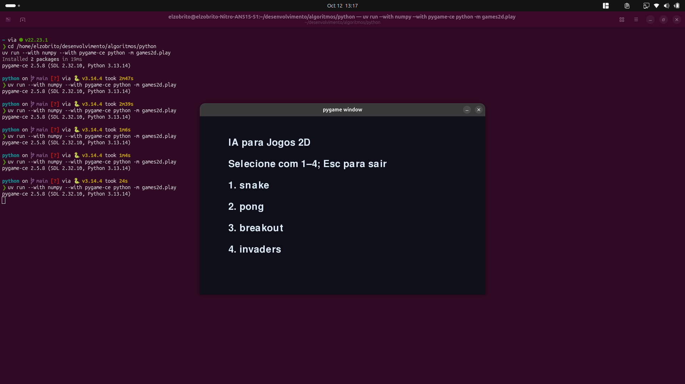

# 30 Algoritmos de IA

Implementações didáticas em **NumPy puro** (sem scikit-learn nem XGBoost). Cada algoritmo cabe em poucas dezenas de linhas, roda de verdade e imprime um `Out:` com o resultado.

Autor: [Elzo Brito](https://github.com/elzobrito) · `@elzobrito`

## Demonstração dos jogos 2D

O pacote [games2d](games2d/README.md) integra Snake, Pong, Breakout e Space
Invaders com agentes de IA (incluindo Q-Learning com sensores de 11 e 14 bits com lookahead de profundidade 2, DQN, CART e Algoritmos Genéticos) e controles humanos.



[Assistir à gravação da demonstração — MP4, 5 min 24 s](assets/games2d/demonstracao.mp4)

Capturas de 12/10/2026. As mídias estão incluídas em
[`assets/games2d`](assets/games2d/) neste repositório.

## Como rodar

```bash
python3 -m pip install numpy
python3 run_all.py
```

Um grupo só:

```bash
python3 g1_supervisionado.py
python3 g2_boosting.py
python3 g3_nao_supervisionado.py
python3 g4_anomalias.py
python3 g5_reforco.py
python3 g6_redes.py
```

Requer Python 3.10+ e NumPy.

## Os 30 algoritmos

| # | Grupo | Algoritmo | O que o código faz |
|---|--------|-----------|--------------------|
| 01 | Supervisionado | Regressão Linear | Equação normal — reta y = 2x + 1 |
| 02 | Supervisionado | Regressão Logística | Softmax + descida de gradiente (iris) |
| 03 | Supervisionado | Árvore de Decisão | CART com Gini, profundidade 3 |
| 04 | Supervisionado | Random Forest | Bagging de árvores com `max_features=√d` |
| 05 | Supervisionado | SVM | LS-SVM com kernel RBF, um-contra-todos |
| 06 | Boosting | k-NN | Maioria dos 5 vizinhos (breast cancer) |
| 07 | Boosting | Naive Bayes | Gaussiano, atributos independentes |
| 08 | Boosting | Gradient Boosting | Árvores de resíduo sobre log-odds |
| 09 | Boosting | AdaBoost | Stumps ponderados (SAMME discreto) |
| 10 | Boosting | XGBoost (mini) | Ganho de 2ª ordem G²/(H+λ) |
| 11 | Não supervisionado | k-Means | k-Means++ e vários `n_init` |
| 12 | Não supervisionado | Aglomerativo | Ligação média até k = 3 |
| 13 | Não supervisionado | DBSCAN | Densidade + ruído |
| 14 | Não supervisionado | PCA | SVD e razão de variância |
| 15 | Não supervisionado | t-SNE | t-SNE exato em 2D (iris) |
| 16 | Anomalias | k-Means++ | Só a inicialização espalhada |
| 17 | Anomalias | Isolation Forest | Caminho médio nas iTrees |
| 18 | Anomalias | Autoencoder | MLP 4→2→4, erro de reconstrução |
| 19 | Anomalias | GMM | EM com 3 gaussianas |
| 20 | Anomalias | Algoritmo genético | Seleção + cruzamento + mutação (16 bits) |
| 21 | Reforço | Q-Learning | Off-policy, corredor de 5 casas |
| 22 | Reforço | SARSA | On-policy no mesmo corredor |
| 23 | Reforço | DQN (mini) | Rede + replay + rede-alvo |
| 24 | Reforço | REINFORCE | Policy gradient no bandit de 3 braços |
| 25 | Reforço | Actor-Critic | Ator + crítico no mesmo bandit |
| 26 | Redes | MLP | Backprop tanh, iris |
| 27 | Redes | CNN | Convolução 2D (filtro de borda) |
| 28 | Redes | RNN | Estado oculto ao longo da sequência |
| 29 | Redes | LSTM | Portões f, i, o e memória c |
| 30 | Redes | Transformer | Atenção softmax(QKᵀ/√d)·V |

## Layout

```
run_all.py                 # dispara os 30
g1_supervisionado.py       # 01–05
g2_boosting.py             # 06–10
g3_nao_supervisionado.py   # 11–15
g4_anomalias.py            # 16–20
g5_reforco.py              # 21–25
g6_redes.py                # 26–30
dados.py                   # iris, breast cancer, blobs, split, métricas
arvores.py                 # CART, regressão e ganho estilo XGBoost
iris.csv                   # 150 flores, 3 classes
breast_cancer.csv          # 569 exames, 2 classes
games2d/                   # jogos 2D, sensores (11/14 bits), agentes RL/GA e visualizador
```

Iris e breast cancer estão no formato dos CSVs do scikit-learn (domínio público). Blobs são sintéticos, com centros bem separados.

## Notas

- O objetivo é **ver o mecanismo**, não competir com scikit-learn.
- Hiperparâmetros são pequenos de propósito (poucas árvores, poucas épocas) para o `run_all.py` terminar em segundos.
- Reforço e redes (21–30) usam ambientes minúsculos (corredor, bandit, 4 tokens) para o `Out:` caber numa linha.
